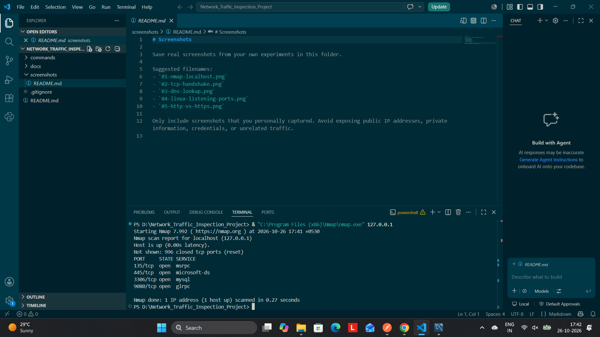
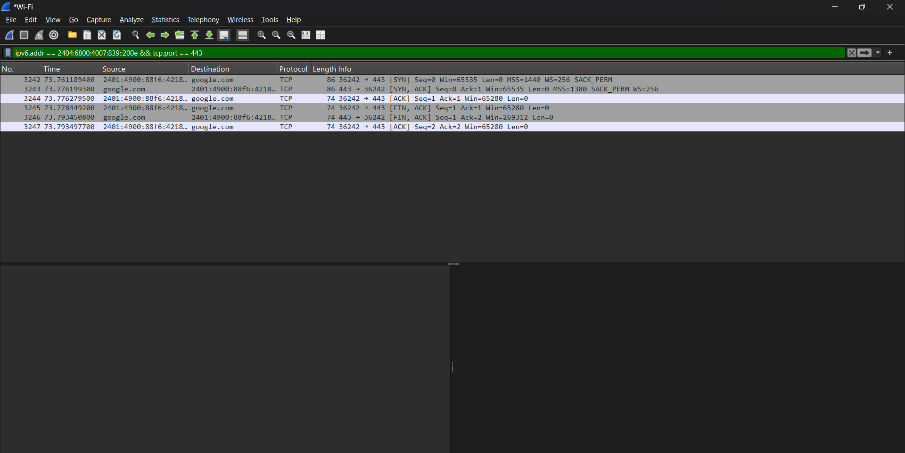
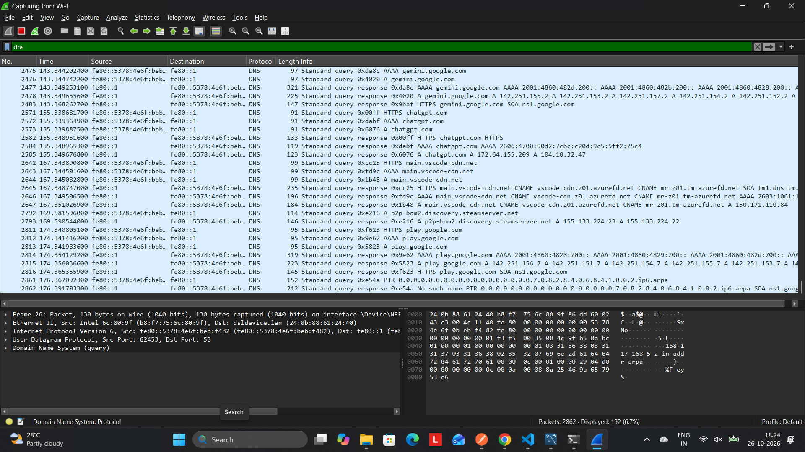
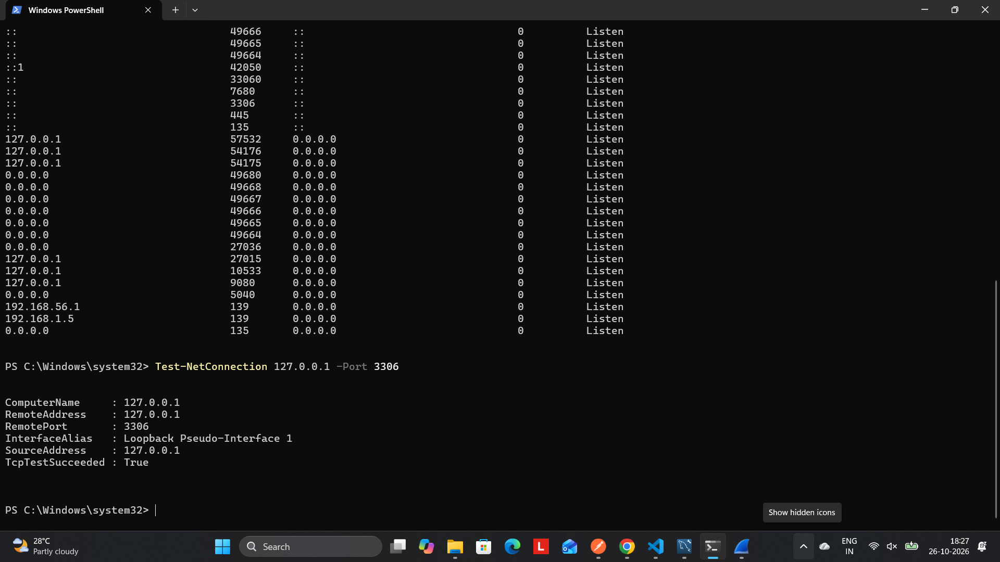
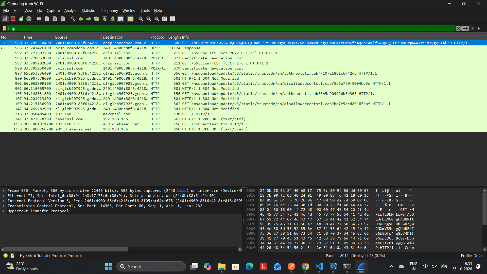
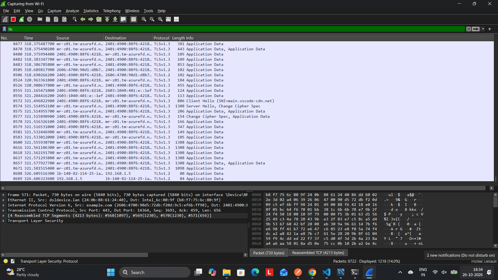

Network Traffic Inspection and Packet Analysis

About the Project

I created this project to practise network analysis using Nmap and Wireshark on my Windows computer. I tried different networking commands and captured packets to understand how devices communicate over a network.

Tools Used

Nmap

Wireshark

Windows PowerShell

TCP/IP

Git and GitHub

Experiments

1. Nmap Scan

I ran nmap 127.0.0.1 to scan my own computer. The scan reported ports such as 135, 445, 3306, and 9080. I checked the service names shown by Nmap.

2. TCP Three-Way Handshake

I used Wireshark to capture traffic while connecting to Google on port 443. I applied TCP filters and examined the SYN, SYN-ACK, and ACK flags to understand how a TCP connection starts.

3. DNS Lookup

I used nslookup to look up Google and YouTube. I also captured network traffic in Wireshark using the dns display filter and checked the DNS queries and responses that appeared.

4. Local Connectivity Test

I used Windows PowerShell to check listening TCP ports with Get-NetTCPConnection -State Listen. I also tested connectivity to Google on port 443 using Test-NetConnection.

5. HTTP and HTTPS Traffic

I captured HTTP traffic in Wireshark and used Follow TCP Stream to read an HTTP request and response. I also captured HTTPS traffic and examined the packets exchanged during the connection. This helped me understand why HTTP content can be readable while HTTPS application data is normally encrypted.
## Screenshots

### 1. Nmap Localhost Scan

### 2. TCP Three-Way Handshake

### 3. DNS Lookup

### 4. Local Connectivity Test

### 5. HTTP Traffic

### 6. HTTPS/TLS Traffic

